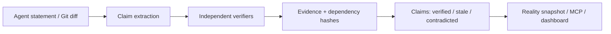

# VERITY

<picture>
  <source media="(prefers-color-scheme: dark)" srcset=".github/assets/verity-header.svg">
  
</picture>

<div align="center">

**The reality layer for AI coding agents.**

> No claim without evidence. No action without reality.

[](https://github.com/Hmoute-Oussama/VERITY/actions/workflows/tests.yml)
[](LICENSE)
[](pyproject.toml)
[](src/verity/server/mcp.py)
[](https://github.com/Hmoute-Oussama/VERITY/stargazers)
[](https://github.com/Hmoute-Oussama/VERITY/issues)

</div>

---

## The problem

Coding agents can confidently report work that is not present, tests that were
never run, or commands whose prerequisites do not exist.

VERITY separates **what an agent claims** from **what the project proves**. It
decomposes statements into claims, verifies those claims with independent
checks, records evidence, and marks evidence stale when a dependency changes.

```text
Agent: "Authentication is implemented and the tests pass."

VERITY:
  [PASS]  Login route exists
  [PASS]  PyJWT dependency is declared
  [FAIL]  Database migration is missing
  [OPEN]  Test suite has not run on this working tree

Result: completion is not justified.
```

<!-- PROJECT-PULSE:START -->
## Project pulse

```text
Commits           1
Python files     29
Test modules      9
Verifiers        17
```

**Branch:** `main` · **Latest:** `e5c9e1d · 2026-11-21` · **Pulse:** `2026-11-21 19:12 UTC`
<!-- PROJECT-PULSE:END -->

## How it works



1. **Analyze** prose, transcripts, commands, or the Git diff.
2. **Verify** through AST, filesystem, package, test, environment, HTTP, and
   security checks.
3. **Persist** evidence and the exact files it depends on in local SQLite.
4. **Invalidate** evidence whose dependencies changed or exceeded their TTL.
5. **Guard** shell actions before they execute.

## Why VERITY is different

| Capability | What it prevents |
|---|---|
| Independent claim verification | An agent's statement being treated as proof |
| Evidence dependency hashes | Old test or code results surviving a source edit |
| Evidence contracts | "Complete" being declared without required checks |
| Hallucination firewall | Commands running without compose files, scripts, imports, or config |
| MCP reality resources | Agents planning from stale or unknown project state |

## Quick start

### Install VERITY

```bash
git clone https://github.com/Hmoute-Oussama/VERITY.git
cd VERITY
python -m venv .venv
```

Windows:

```powershell
.venv\Scripts\Activate.ps1
python -m pip install -e ".[dev]"
```

macOS/Linux:

```bash
source .venv/bin/activate
python -m pip install -e ".[dev]"
```

### Initialize a project

```bash
cd /path/to/your-project
verity init
```

VERITY creates:

```text
.verity/config.yaml       committed project configuration
.verity/contracts.yaml    committed completion requirements
.verity/verity.db         local evidence (gitignored)
```

### Verify an agent statement

```bash
verity analyze "I implemented authentication and all tests pass" --diff
verity verify
verity status
```

### Check completion requirements

```yaml
# .verity/contracts.yaml
version: 1
task: authentication

contracts:
  - id: login_route
    claim: POST /login exists.
    verifier: code_route
    args:
      path: /login
      method: POST
    required: true

  - id: tests_pass
    claim: The test suite passes.
    verifier: test_execution
    required: true

  - id: no_secrets
    claim: No secrets are committed.
    verifier: secret_scan
    required: true
```

```bash
verity contract check
```

## The hallucination firewall

VERITY can check a command before it runs:

```bash
verity guard "docker compose up --build"
```

```text
VERDICT: BLOCK
ACTION: docker compose up --build
- Docker Compose configuration exists: missing
  Hint: create compose.yaml or docker-compose.yml
```

Or guard and execute in one step:

```bash
verity run "npm test"
```

The guard understands Docker Compose, Dockerfiles, npm/pnpm/yarn scripts,
Python/Node scripts, imports, migrations, test tools, build tools, and project
command policies.

## Connect a coding agent

```bash
verity integrate claude
verity integrate codex
verity integrate opencode
verity integrate cursor
verity integrate vscode
verity integrate --all
```

Supported integrations include Claude Code, Codex, OpenCode, Cursor, GitHub
Copilot for VS Code, Windsurf, and Gemini CLI.

Then run:

```bash
verity mcp
```

### MCP tools

| Tool | Purpose |
|---|---|
| `verity_reality` | Read the current reality snapshot |
| `verity_check_action` | Allow, warn, or block a shell action |
| `verity_verify_claim` | Decompose and verify a statement |
| `verity_list_claims` | Inspect claims and statuses |
| `verity_verify` | Re-run verification |
| `verity_scan` | Find unsupported assumptions |
| `verity_contract_check` | Check completion contracts |

Claude Code can also install a real `PreToolUse` hook:

```bash
verity integrate claude --hooks
```

See [Agent integrations](docs/integrations.md) for configuration details.

## Claim and evidence model

A claim may be:

| Status | Meaning |
|---|---|
| `verified` | Current evidence passes |
| `partially_verified` | Some evidence passes and some warns |
| `unverified` | No current proof exists |
| `contradicted` | Evidence disproves the claim |
| `stale` | A dependency changed or evidence expired |

Each evidence record can store a summary, details, payload, confidence,
commit, timestamp, and SHA-256 digests for every file it depended on.

```text
Verify login.py  -> evidence E1  -> login.py digest abc123
Edit login.py    -> evidence E1 becomes stale
Verify again     -> evidence E2  -> login.py digest def456
```

## Verifiers

| Verifier | Proves |
|---|---|
| `code_symbol` / `code_route` | Source symbols and HTTP routes exist |
| `syntax` / `imports` | Source parses and imports resolve |
| `file_exists` / `config_valid` / `json_path` | Files and configuration are valid |
| `dependency` | Packages are declared and available |
| `test_execution` / `command` | Allowlisted commands pass |
| `environment` | Runtime and environment requirements exist |
| `secret_scan` / `security_analysis` | Obvious credential and security risks |
| `database_schema` | Tables or columns exist |
| `http_probe` | Local endpoints respond |
| `manual` | A human explicitly attests a claim |
| `none` | A claim is recorded as an assumption, not proof |

Command execution is allowlist-only unless explicitly enabled in
`.verity/config.yaml`.

## CLI reference

| Command | Purpose |
|---|---|
| `verity init` | Scaffold project configuration |
| `verity status` | Report current reality |
| `verity analyze "<text>" --diff` | Extract and verify claims |
| `verity verify` | Re-run verifiers |
| `verity claim list/show/add/rm` | Manage claims |
| `verity evidence` | Inspect evidence records |
| `verity invalidate` | Identify stale evidence |
| `verity snapshot` | Generate agent context |
| `verity graph` | Render the evidence graph |
| `verity contract check` | Verify completion requirements |
| `verity guard "<command>"` | Check action prerequisites |
| `verity run "<command>"` | Guard, then execute |
| `verity scan` | Find unsupported assumptions |
| `verity integrate` | Configure a coding agent |
| `verity mcp` | Start the MCP server |
| `verity serve` | Start the local dashboard |

Most commands support `--json` for automation.

## Architecture

```text
src/verity/
  cli.py                 Typer CLI
  engine.py              analyze / verify / invalidation orchestration
  db.py                  SQLite evidence repository
  claims/                claim extraction
  evidence/              independent verifiers
  guard.py               action firewall and assumption scanning
  contracts.py           completion requirements
  integrations.py        coding-agent configuration
  server/mcp.py          MCP stdio server
  server/http.py         local API and dashboard
  graph.py               claim -> evidence -> artifact graph
  snapshot.py            agent-facing reality context
```

Design principles:

- Agent statements are claims, never evidence.
- Checks are deterministic and explainable.
- The SQLite evidence store is local-first.
- Evidence must match the current working tree.
- Blocking is conservative: concrete contradictions are blocked; uncertainty is
  surfaced.

## Development

```bash
python -m pip install -e ".[dev]"
pytest
```

Python 3.10+; dependencies are Typer, Rich, and PyYAML.

## Roadmap

- GitHub Action and pull-request evidence comments
- Signed evidence bundles for CI
- OpenAPI, migration, and runtime trace verifiers
- Shared team evidence store
- VS Code and richer dashboard experiences

## Contributing

Contributions are welcome:

1. Fork the repository.
2. Create a focused feature branch.
3. Add or update pytest coverage.
4. Run `pytest`.
5. Open a pull request with the evidence for the change.

## License

MIT — see [LICENSE](LICENSE).
